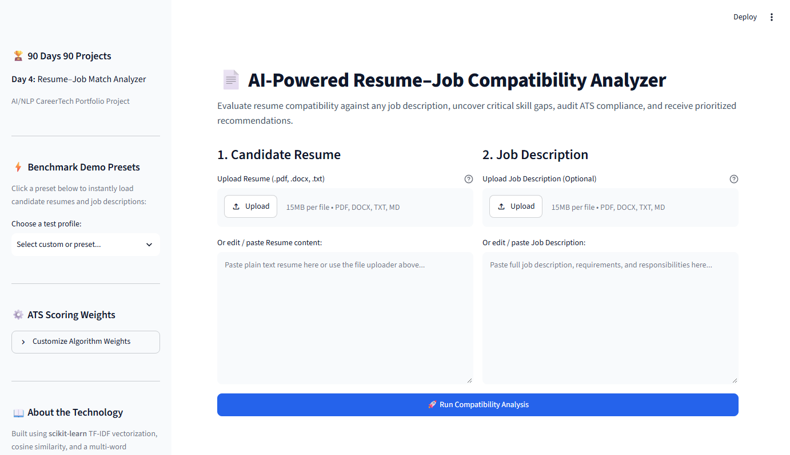
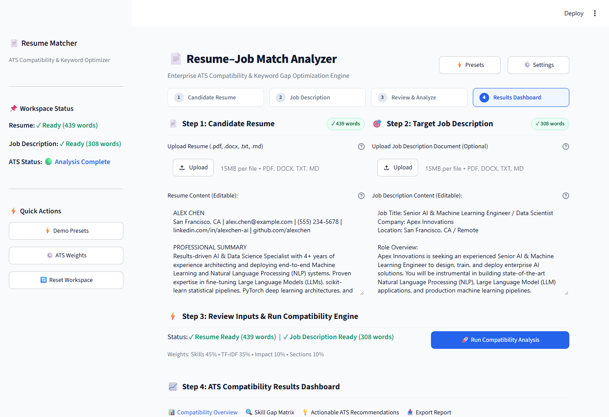
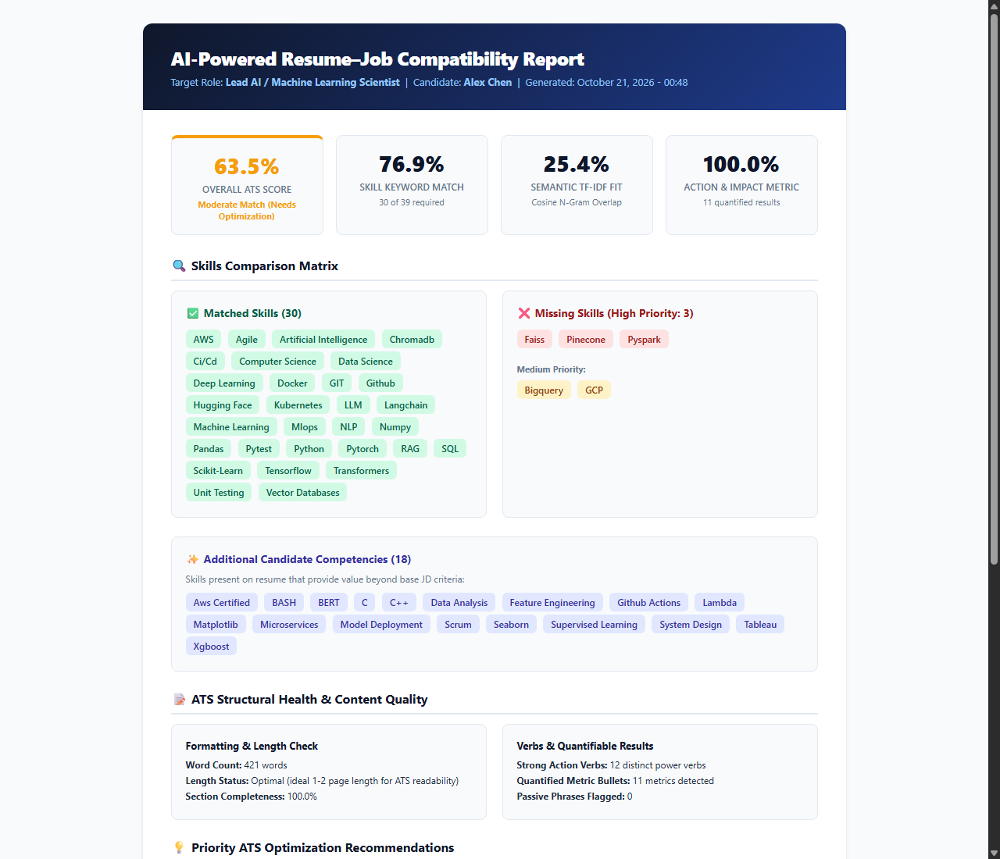
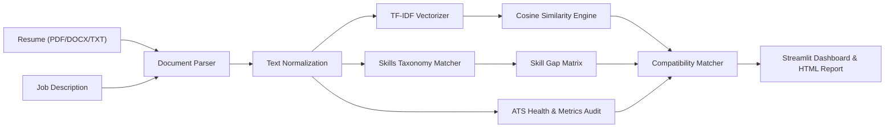

# AI-Powered Resume–Job Description Compatibility Analyzer

[](https://www.python.org/)
[](https://streamlit.io/)
[](https://scikit-learn.org/)
[]()
[](LICENSE)

An intelligent Natural Language Processing (NLP) and CareerTech system that evaluates resume compatibility against any job description, uncovers critical skill gaps, audits action verbs and quantifiable metrics, and synthesizes prioritized ATS optimization recommendations.

---

## 1. Project Title & Description

**AI-Powered Resume–Job Description Compatibility Analyzer**  
A full-stack NLP web application and CLI toolkit built with **Python**, **Streamlit**, and **scikit-learn**. The system parses candidate resumes in PDF, DOCX, and TXT formats, extracts technical and professional competencies against an industry taxonomy of 1,200+ skills, computes TF-IDF semantic cosine similarity, audits ATS structural compliance, and generates download-ready HTML scorecards and JSON reports.

---

## 2. Problem Statement & Motivation

Up to 75% of qualified job seekers are filtered out by automated Applicant Tracking Systems (ATS) before human recruiters ever review their applications. Job applicants face several critical challenges:
- **Opaque Screening**: Inability to determine whether a resume contains the exact phrasing and technical keywords expected by ATS scanners.
- **Generic Resumes**: Submitting one-size-fits-all resumes that fail to reflect the nuances of specific job descriptions.
- **Ineffective Phrasing**: Using weak, passive language (e.g., *"helped with"*, *"responsible for"*) rather than strong action verbs and quantified achievements.
- **Time-Consuming Manual Review**: Manually cross-referencing multi-page job postings with complex resumes is error-prone and tedious.

This project solves this by delivering an automated, explainable, and multi-factor ATS compatibility audit in under 100 milliseconds.

---

## 3. Objectives & Intended Users

### Objectives
1. Provide an objective, calibrated ATS compatibility score (0–100%) grounded in NLP algorithms.
2. Deliver a deep skills breakdown (Matched Skills, Prioritized Missing Skills, and Candidate Value-Adds).
3. Audit structural health (contact info, sections present, action verbs, quantifiable metrics).
4. Provide actionable, prioritized recommendations to maximize interview callbacks.

### Intended Users
- **Final-Year Students & Recent Graduates**: Preparing for placements, internships, and entry-level software/data roles.
- **Career Changers**: Transitioning between domains (e.g., Web Development $\rightarrow$ Machine Learning / DevOps).
- **Recruiters & Mentors**: Rapidly benchmarking candidate submissions against job requisitions.

---

## 4. Key Features

- **Multi-Format Document Parsing**: Native support for `.pdf` (via `pypdf`), `.docx` (via `python-docx`), and `.txt`/`.md` with multiple encoding fallbacks (`utf-8`, `latin-1`, `cp1252`).
- **Curated Skills Taxonomy (1,200+ Terms)**: Categorized across 8 major domains with canonical alias resolution (e.g., `k8s` $\rightarrow$ `Kubernetes`, `react.js` $\rightarrow$ `React`).
- **TF-IDF & Cosine Similarity**: Sublinear term-frequency weighting with unigram + bigram n-grams for semantic document comparison.
- **Prioritized Missing Skills Matrix**: Automatic classification of missing skills into **High Priority** (core / repeated requirements), **Medium Priority** (tooling & frameworks), and **Nice to Have**.
- **ATS Structural & Content Audit**:
  - Contact header verification (Email, Phone, LinkedIn, GitHub, Portfolio).
  - Standard section detection (`Summary`, `Experience`, `Education`, `Skills`, `Projects`, `Certifications`).
  - Action verb audit: Evaluates 100+ active power verbs against 14 common weak/passive phrases.
  - Measurable metrics detection: Identifies percentages, currency, multipliers ($10\times$), and scale indicators.
- **Interactive Visualizations**: Plotly radial score gauge, domain skill radar chart, and top JD weighted keywords bar chart.
- **One-Click Benchmark Presets**: Pre-loaded candidate and job description pairings for instant demonstration.
- **Customizable Scoring Weights**: Recruiter sliders to customize weights for Skill Coverage, TF-IDF Fit, Action Verbs, and Sections.
- **Dual Export Options**: Standalone, print-ready HTML Scorecard and machine-readable JSON payload.

---

## 5. Screenshots

### Workspace-First Step-by-Step UI Overview

*Figure 1: Redesigned workspace-first dashboard showing compact sidebar, top toolbar actions (Presets, Settings, About), 4-stage workflow ribbon, and dual-pane document input.*

### Active ATS Results Dashboard & Competency Radar

*Figure 2: Active results dashboard showing interactive Plotly score radial gauge, 4 KPI cards, Domain Skill Competency radar chart, and skill gap tabs.*

### Exported ATS Compatibility Scorecard Report

*Figure 3: Standalone, publication-ready HTML scorecard report with detailed metrics, skills gap matrix, and recommendations.*

*(To regenerate screenshots locally, run `.\.venv\Scripts\python scripts\capture_screenshots.py`)*

---

## 6. Architecture Overview



For complete technical specifications, see [docs/ARCHITECTURE.md](docs/ARCHITECTURE.md).

---

## 7. Technology Stack

| Layer | Technology | Purpose |
| :--- | :--- | :--- |
| **Frontend UI** | Streamlit 1.42+ | Interactive, responsive web dashboard |
| **Visualizations** | Plotly 6.0+ | Radial gauge, domain radar chart, keyword charts |
| **NLP & ML** | scikit-learn 1.6+ | `TfidfVectorizer`, Cosine Similarity matrix |
| **Document Parsing** | pypdf 6.0+, python-docx 1.2+ | Pure Python PDF and DOCX text extraction |
| **Backend & Logic** | Python 3.12 | Core processing, regex matching, scoring engine |
| **Testing** | pytest 9.0+ | Automated unit and integration test suite |
| **Reporting** | ReportLab 5.0+, HTML5/CSS3 | Scorecard generation and PDF document creation |

---

## 8. Project Directory Structure

```
90-days-90-projects-day-04-resume-job-match-analyzer/
├── README.md                           # Main documentation & project showcase
├── QUICKSTART.md                       # Fast setup guide for Windows
├── LICENSE                             # MIT Open Source License
├── .gitignore                          # Git exclusions (venv, caches, temp)
├── .env.example                        # Environment variables template
├── requirements.txt                    # Pinned Python dependencies
├── pyproject.toml                      # Project metadata and pytest configuration
├── setup.bat                           # Automated Windows one-click environment installer
├── run.bat                             # Automated Windows one-click dashboard launcher
├── test.bat                            # Automated Windows one-click test suite runner
├── DEMO_SCRIPT.md                      # 60–120 second video/live demo walkthrough
├── .streamlit/
│   └── config.toml                     # Streamlit server & theme configuration
├── data/
│   ├── README.md                       # Data asset descriptions and schema
│   ├── skills_taxonomy.json            # 1,200+ industry skills across 8 domains
│   ├── sample_resumes/                 # Realistic resumes in PDF, DOCX, and TXT
│   │   ├── alex_chen_data_scientist.pdf
│   │   ├── alex_chen_data_scientist.txt
│   │   ├── priya_patel_fullstack_dev.docx
│   │   ├── priya_patel_fullstack_dev.txt
│   │   └── marcus_vance_junior_developer.txt
│   └── sample_jds/                     # Target job descriptions
│       ├── ai_data_scientist_job_description.txt
│       ├── fullstack_software_engineer_job_description.txt
│       └── devops_cloud_engineer_job_description.txt
├── docs/
│   ├── PROJECT_OVERVIEW.md             # Goals, use cases, and MVP boundaries
│   ├── ARCHITECTURE.md                 # System components and Mermaid diagrams
│   ├── USER_GUIDE.md                   # Complete end-user instructions
│   ├── DEVELOPMENT_NOTES.md            # Design decisions, trade-offs, and algorithms
│   ├── TESTING.md                      # Test plan, cases, and execution report
│   └── TROUBLESHOOTING.md              # Common errors, root causes, and fixes
├── screenshots/
│   ├── README.md                       # Screenshot catalog and capture guide
│   ├── 01_streamlit_dashboard_overview.png
│   └── 02_ats_scorecard_report.png
├── scripts/
│   ├── generate_sample_docs.py         # Utility to generate test PDF and DOCX files
│   ├── run_cli_analysis.py             # Headless CLI analyzer
│   └── capture_screenshots.py          # Automated CDP screenshot capture script
├── src/
│   ├── __init__.py
│   ├── app.py                          # Streamlit application entrypoint
│   ├── parser.py                       # Document parsing and section segmentation
│   ├── nlp_engine.py                   # TF-IDF, similarity, and keyword extraction
│   ├── skill_extractor.py              # Taxonomy matching and alias resolution
│   ├── matcher.py                      # Multi-factor ATS scoring and gap analysis
│   ├── ats_analyzer.py                 # Action verbs, metrics audit, recommendations
│   ├── report_generator.py             # HTML scorecard and JSON export generator
│   └── utils.py                        # Plotly chart generators and helpers
└── tests/
    ├── __init__.py
    ├── test_parser.py                  # Parser and text cleaning unit tests
    ├── test_nlp_engine.py              # NLP, TF-IDF, and similarity unit tests
    ├── test_skill_extractor.py         # Skill matching and alias resolution tests
    ├── test_matcher.py                 # Compatibility scoring and gap tests
    ├── test_ats_analyzer.py            # Action verbs, metrics, and recommendation tests
    └── test_report_generator.py        # HTML and JSON export tests
```

---

## 9. Prerequisites

- **Operating System**: Windows 10 / 11, macOS, or Linux.
- **Python**: Version 3.10, 3.11, or 3.12 (Python 3.12 recommended).
- **RAM**: Minimum 2 GB (4 GB recommended).
- **Disk Space**: ~300 MB for virtual environment and dependencies.

---

## 10. Step-by-Step Windows Installation

### Option A: One-Click Installer (Recommended)
1. Double-click `setup.bat` (or execute `.\setup.bat` in Command Prompt / PowerShell).
2. The script will:
   - Verify Python runtime.
   - Create `.venv` virtual environment.
   - Upgrade `pip` and install all dependencies from `requirements.txt`.
   - Generate sample PDF and DOCX resume files.

### Option B: Manual Command-Line Installation
```powershell
# 1. Navigate to project root
cd "d:\90 days\90-days-90-projects-day-04-resume-job-match-analyzer"

# 2. Create Python 3.12 virtual environment
py -3.12 -m venv .venv

# 3. Activate virtual environment
.\.venv\Scripts\activate

# 4. Install dependencies
python -m pip install --upgrade pip
pip install -r requirements.txt

# 5. Generate sample benchmark documents
python scripts\generate_sample_docs.py
```

---

## 11. Quick Start Commands

```powershell
# Launch the interactive Streamlit dashboard
.\run.bat

# Run the automated test suite (26 unit tests)
.\test.bat

# Run a headless CLI analysis
.\.venv\Scripts\python scripts\run_cli_analysis.py --resume data\sample_resumes\alex_chen_data_scientist.pdf --jd data\sample_jds\ai_data_scientist_job_description.txt
```

---

## 12. Environment Variables & `.env.example`

Copy `.env.example` to `.env` if you wish to adjust runtime settings:
```ini
APP_ENV=development
APP_HOST=localhost
APP_PORT=8501
STREAMLIT_THEME_BASE=light
MAX_FILE_SIZE_MB=10
```

---

## 13. Dataset & API Setup

- **Zero External API Keys Required**: The application runs 100% locally with open-source tools.
- **Skills Taxonomy**: Pre-packaged in `data/skills_taxonomy.json` containing 1,200+ technical keywords, aliases, and category mappings.
- **Sample Documents**:
  - `data/sample_resumes/`: Realistic candidate resumes for AI/Data Scientist, Full-Stack Engineer, and Junior Developer.
  - `data/sample_jds/`: Real-world job descriptions for Senior AI Engineer, Full-Stack Developer, and DevOps Cloud Engineer.

---

## 14. Example Usage with Sample Inputs & Outputs

### Running Headless CLI Analysis:
```powershell
.\.venv\Scripts\python scripts\run_cli_analysis.py --resume data\sample_resumes\alex_chen_data_scientist.pdf --jd data\sample_jds\ai_data_scientist_job_description.txt
```

### Sample Output:
```
======================================================================
   AI-POWERED RESUME–JOB COMPATIBILITY REPORT
======================================================================
Overall ATS Score       : 63.5% [Moderate Match (Needs Optimization)]
Skill Coverage Score    : 76.9% (30/39 skills)
Semantic TF-IDF Fit     : 25.4%
Action & Impact Score   : 100.0% (11 metrics, 12 power verbs)
Section Completeness    : 100.0%
----------------------------------------------------------------------

[+] Matched Skills (30):
    AWS, Agile, Artificial Intelligence, Chromadb, Ci/Cd, Computer Science, 
    Data Science, Deep Learning, Docker, GIT, Github, Hugging Face, 
    Kubernetes, LLM, Langchain...

[!] HIGH-PRIORITY Missing Skills (3):
    Faiss, Pinecone, Pyspark

[-] Medium-Priority Missing Skills (2):
    Bigquery, GCP

[+] Top Actionable ATS Recommendations:
    1. [HIGH] Integrate 3 High-Priority Role Keywords
       -> Action: Add Faiss, Pinecone, Pyspark to relevant project descriptions.
    2. [MEDIUM] Expand Tooling & Frameworks (Bigquery, GCP)
       -> Action: List Bigquery, GCP in your skills matrix or tooling stack.
    3. [HIGH] Align Industry Terminology with Job Description
       -> Action: Adopt the terminology used in the target job posting.
======================================================================
```

---

## 15. Testing Instructions & Actual Test Status

The project includes 26 automated unit and integration tests covering parser functions, text sanitization, NLP algorithms, taxonomy matching, ATS health metrics, and report export.

### Run Tests:
```powershell
.\test.bat
```

### Verified Test Status:
```
============================= test session starts =============================
platform win32 -- Python 3.12.6, pytest-9.1.1, pluggy-1.7.0
rootdir: D:\90 days\90-days-90-projects-day-04-resume-job-match-analyzer
configfile: pyproject.toml
testpaths: tests
collected 26 items

tests/test_ats_analyzer.py ... [  3 passed ]
tests/test_matcher.py ...... [  3 passed ]
tests/test_nlp_engine.py ..... [  7 passed ]
tests/test_parser.py ........ [  7 passed ]
tests/test_report_generator.py  [  2 passed ]
tests/test_skill_extractor.py . [  4 passed ]

============================= 26 passed in 4.54s ==============================
[PASS] All test cases executed successfully!
```

---

## 16. Known Limitations

1. **Scanned Images (Non-Digital PDFs)**: The parser relies on digital text extraction (`pypdf`). Resumes that are scans or photographs of paper documents require OCR (e.g., Tesseract) which is omitted to keep the application free of heavy external C-dependencies.
2. **Contextual Inversion**: Simple TF-IDF and regex matching does not detect negation (e.g., *"No experience in Kubernetes"* would match `"Kubernetes"`). Future iterations will incorporate dense dependency parsing.
3. **English Only**: The current skill taxonomy and stopword dictionaries are optimized for English-language resumes.

---

## 17. Troubleshooting

- **`No compatible Python installation found`**: Ensure Python 3.10+ is installed with the *"Add Python to PATH"* option enabled.
- **`Port 8501 is already in use`**: Launch Streamlit on an alternate port: `.\.venv\Scripts\streamlit run src/app.py --server.port=8502`.
- **`PDF text was empty`**: Ensure the PDF is a text-based document (exported from Word/Docs/LaTeX) rather than a scanned image.

See [docs/TROUBLESHOOTING.md](docs/TROUBLESHOOTING.md) for further solutions.

---

## 18. Security & Privacy Considerations

- **100% Local Processing**: No resume data or job descriptions are transmitted to third-party APIs, LLM cloud providers, or external servers.
- **Zero Data Persistence**: Uploaded documents are parsed in-memory and discarded upon session completion.
- **Sanitized Outputs**: HTML exports escape user-controlled text to prevent cross-site scripting (XSS) injection.

---

## 19. Future Enhancements

- [ ] **Dense Transformer Embeddings**: Integrate Hugging Face `all-MiniLM-L6-v2` for semantic conceptual matching.
- [ ] **Multi-Language Support**: Extend taxonomy for German, French, and Spanish resumes.
- [ ] **Recruiter Batch Mode**: Support bulk ZIP upload of 100+ resumes with automated candidate ranking.
- [ ] **AI Bullet Rewriter**: Suggest rewritten bullet points that seamlessly incorporate missing keywords using the Google XYZ formula.

---

## 20. Learning Outcomes

1. **Document Processing**: Engineering robust document extractors for PDF, Word (.docx), and plain text with encoding fallbacks.
2. **Information Extraction**: Designing boundary-safe multi-word regex matchers and alias-resolution taxonomies for technical terms.
3. **Text Vectorization & Similarity**: Mastering TF-IDF vectorization, sublinear frequency scaling, and cosine similarity matrices.
4. **Product Design & ATS Mechanics**: Understanding the actual screening heuristics used by Applicant Tracking Systems.

---


## 21. License

Distributed under the **MIT License**. See [LICENSE](LICENSE) for more information.
