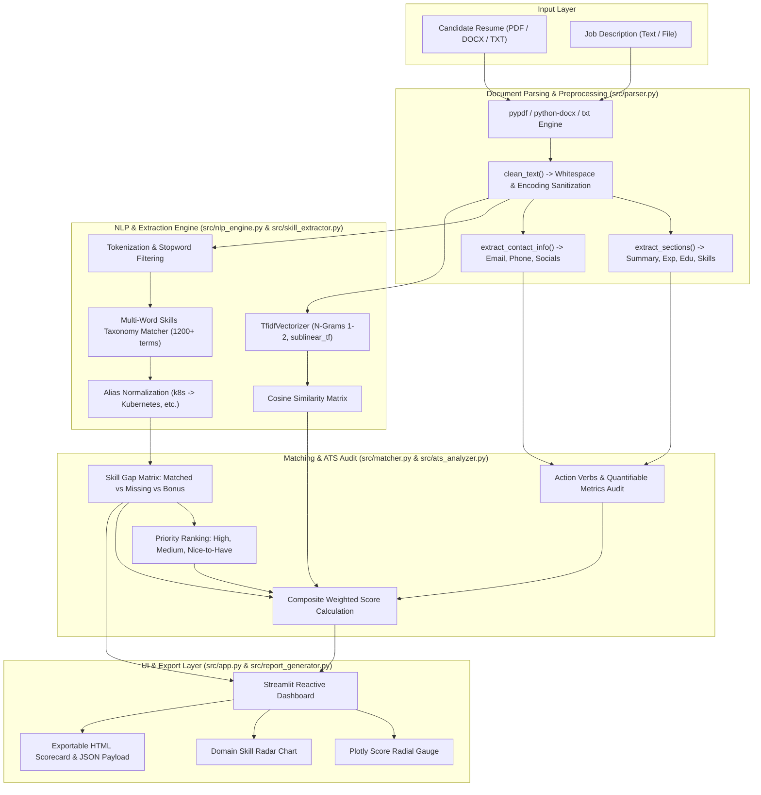

# System Architecture: Resume–Job Match Analyzer

---

## 1. Architectural Components

### A. Document Parser (`src/parser.py`)
- **`extract_text_from_file()`**: Dynamically routes files based on extension (`.pdf`, `.docx`, `.txt`).
- **`clean_text()`**: Normalizes line breaks, removes null/control bytes, and collapses whitespace.
- **`extract_sections()`**: Scans line headers with fuzzy regex patterns to identify major sections (`Summary`, `Experience`, `Education`, `Skills`, `Projects`, `Certifications`).
- **`extract_contact_info()`**: Regex engine extracting email, phone, LinkedIn URL, GitHub URL, and personal portfolio links.

### B. NLP & Vectorization Engine (`src/nlp_engine.py`)
- **Tokenization**: Custom regex tokenizer supporting hyphenated technical terms, slashes (`ci/cd`), pluses (`c++`), and hashes (`c#`).
- **TF-IDF Vectorizer**: Scikit-Learn `TfidfVectorizer` with `ngram_range=(1, 2)`, English stop words, and `sublinear_tf=True` to dampen the impact of repetitive tokens.
- **Cosine Similarity**: Vector dot product normalized by Euclidean norm:
  $$\text{Cosine Similarity} = \frac{\mathbf{u} \cdot \mathbf{v}}{\|\mathbf{u}\| \|\mathbf{v}\|}$$

### C. Skill Extraction & Taxonomy Matcher (`src/skill_extractor.py`)
- **Taxonomy Knowledge Base**: Categorized database of 1,200+ tech competencies across 8 domains:
  1. Programming Languages
  2. AI, ML & Data Science
  3. Web & App Frameworks
  4. Cloud & DevOps
  5. Databases & Storage
  6. Software Engineering & Tools
  7. Soft Skills & Leadership
  8. Certifications & Education
- **Alias Resolution**: Canonical normalization (e.g. `k8s` $\rightarrow$ `Kubernetes`, `react.js` $\rightarrow$ `React`, `sklearn` $\rightarrow$ `Scikit-Learn`).
- **Phrase Boundary Handling**: Word-boundary regex for multi-word phrases and symbol-safe patterns for `c++`, `c#`, `.net`.

### D. Compatibility Matcher (`src/matcher.py`)
- Evaluates skill intersections:
  - $\text{Matched} = \text{Resume Skills} \cap \text{JD Skills}$
  - $\text{Missing} = \text{JD Skills} \setminus \text{Resume Skills}$
  - $\text{Additional} = \text{Resume Skills} \setminus \text{JD Skills}$
- **Missing Skills Priority Heuristic**:
  - **High Priority**: Mentioned $\ge 3$ times in JD, or present among top TF-IDF keywords, or belongs to Core Programming / AI domains.
  - **Medium Priority**: Mentioned $\ge 2$ times, or secondary frameworks/databases.
  - **Low Priority**: General or single-mention nice-to-haves.

### E. ATS Health & Quality Audit (`src/ats_analyzer.py`)
- **Action Verbs**: Evaluates 100+ active power verbs vs 14 common weak/passive phrases.
- **Quantifiable Metrics**: Detects percentages, dollar amounts, performance multipliers ($10\times$), team scale, and user scale indicators.
- **Section Completeness**: Weights presence of critical sections (Experience, Skills, Education) and recommended sections (Summary, Projects, Certifications).

### F. Scoring Formula
The composite ATS compatibility score is calculated using calibrated default weights:

$$\text{Overall ATS Score} = (0.45 \times \text{Skill Coverage}) + (0.35 \times \text{TF-IDF Similarity}) + (0.10 \times \text{Action/Impact Score}) + (0.10 \times \text{Section Completeness})$$

Users can interactively adjust these weights in the sidebar based on specific recruiter criteria.
